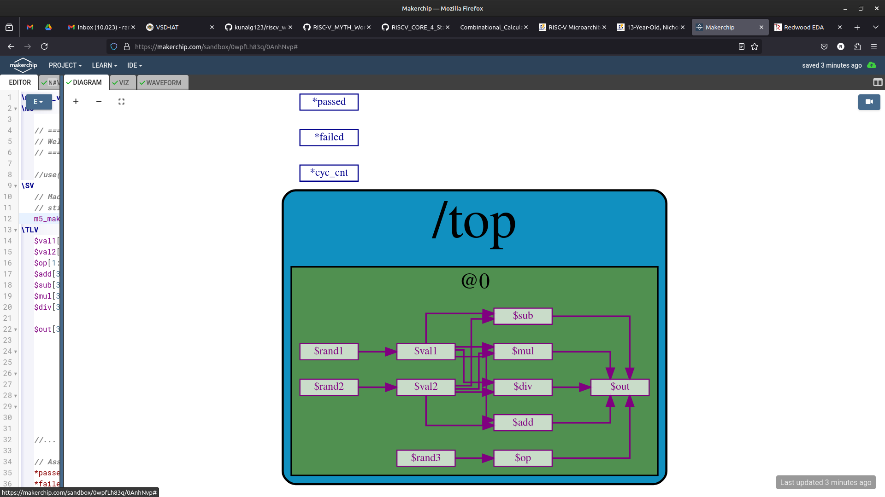

# RISC-V_MYTH_workshop

My exercises from the RISC-V MYTH (Microprocessor for You in Thirty Hours)
workshop by VSD and Redwood EDA. They are written in TL-Verilog, a
transaction-level extension of Verilog that makes pipelines easy to describe.

## What's inside (`Day3/`)

| File | What it does |
|---|---|
| `calculator.tlv` | Calculator: add, subtract, multiply or divide two random inputs, chosen by an opcode |
| `counter.tlv` | Free-running counter with reset |
| `fibonacci_series.tlv` | Fibonacci sequence, using values from previous cycles (`>>1`, `>>2`) |
| `pythagores_Theorem.tlv` | Pipelined Pythagoras: squares in stage 1, sum in stage 2, square root in stage 3, with a valid signal |
| `sequential_calculator.tlv` | Empty for now: the next exercise |

## Try it

Paste a `.tlv` file into the [Makerchip](https://makerchip.com/sandbox/) IDE in
your browser and press compile to see the waveform and diagram.
